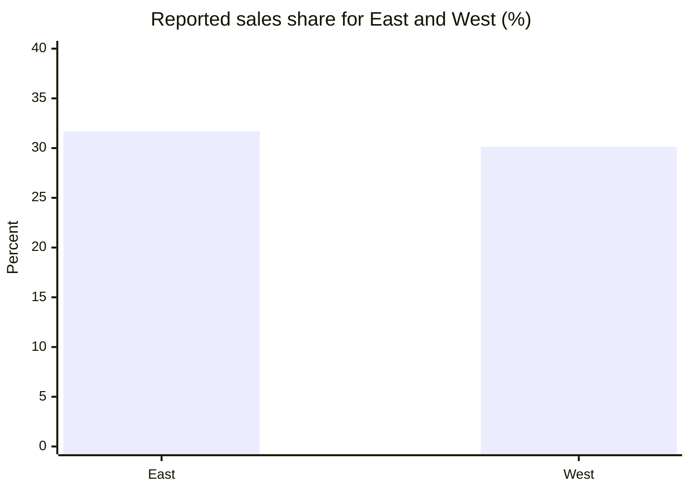

# Superstore Sales Dashboard - Power BI

This project presents an interactive Power BI analysis of Superstore sales performance. The dashboard was built from a Kaggle Superstore dataset and includes data cleaning, dimensional modeling, and report design.

## Management readout

| Observation | Decision or follow-up |
| --- | --- |
| East accounts for 31.69% of reported sales; West accounts for 30.14%. Together they contribute 61.83%. | Prioritize a regional drill-down when reviewing national performance. |
| East leads West by 1.55 percentage points of sales share. | Compare category mix and margins before shifting targets between these two regions. |
| Reported profit is 145.45K on 836.15K in sales, about a 17.4% aggregate profit-to-sales ratio. | Compare regional and category margins against this baseline to locate potential outliers. |

These observations use the report totals and regional shares shown in the PBIX summary. Use the report filters to verify the period and product mix before drawing conclusions from a subset.

## Dashboard coverage

- Total sales, total profit, and total orders
- Sales trend over time
- Category and regional sales comparison
- Regional sales distribution
- Sales versus profit analysis
- Category and region filters

## Reported results

| Metric | Value |
| --- | ---: |
| Total sales | 836.15K |
| Total profit | 145.45K |
| Total orders | 2K |
| East regional sales share | 31.69% |
| West regional sales share | 30.14% |

## Files

- `DV FINAL JURY 1.pbix` - editable Power BI report
- `power-bi-dv-presentation.pptx` - presentation summarizing the dashboard

## Data model

The report uses `cleaned_superstore` as the primary table, with supporting date, category, region, and subcategory dimension tables.

## How to use

1. Download the `.pbix` file.
2. Open it in Power BI Desktop.
3. Use the category and region filter to explore the visuals.

## Source

The original dataset was obtained from Kaggle. This repository contains the project report and presentation assets, not the original raw dataset.
